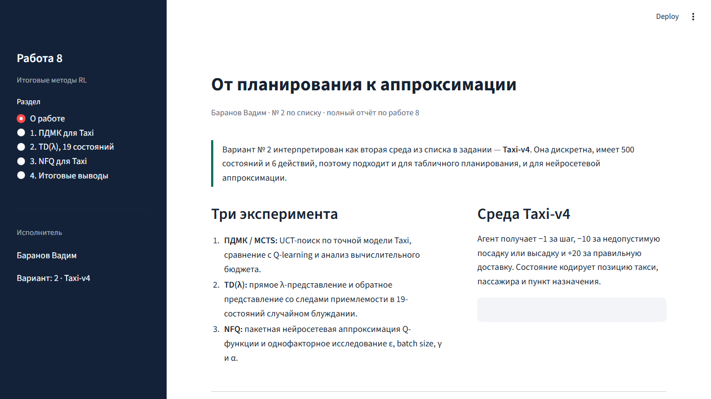

# 🚕 Лабораторная работа 2 · От планирования к аппроксимации

<div align="center">

**ПДМК / MCTS с UCT · Q-learning · TD(λ) · NFQ**


</div>

## 📚 О работе

Продолжение исследования планирования в обучении с подкреплением. Работа сочетает планирование по дереву поиска, TD-методы и нейросетевую аппроксимацию функции ценности. Исходный материал сохранён в `ЛР2_Планирование_продолжение_8_2.ipynb`.

> **Исполнитель:** Баранов Вадим, № 2 по списку.

## ✅ Реализовано

- ПДМК / MCTS с UCT и точной моделью среды Taxi;
- сравнение планирования и Q-learning;
- исследование глубины траектории и количества симуляций;
- прямое и обратное представления TD(λ) для случайного блуждания с 19 состояниями;
- NFQ для Taxi с настройкой `ε`, `γ`, `α` и размера пакета.

## 🖥️ Интерфейс



Приложение содержит три страницы экспериментов: MCTS в Taxi, сравнение вариантов TD(λ) и NFQ. Управляющие параметры доступны в боковой панели.

## 🗂️ Структура проекта

| Файл | Назначение |
|---|---|
| `ЛР2_Планирование_продолжение_8_2.ipynb` | Исходный учебный ноутбук |
| `algorithms.py` | Планирование, TD-методы и вспомогательные функции |
| `nfq.py` | Нейросетевая аппроксимация Q-функции |
| `app.py` | Streamlit-интерфейс экспериментов |
| `test_algorithms.py` | Автоматические проверки |
| `requirements.txt` | Зависимости проекта |

## 🚀 Запуск

```powershell
py -3.12 -m pip install -r requirements.txt
py -3.12 -m streamlit run app.py
```

Код поддерживает `Taxi-v4` в новых версиях Gymnasium и `Taxi-v3` в прежних. Первый запуск NFQ требует больше времени на обучение, после чего результаты кэшируются Streamlit.

## 🧪 Проверка

```powershell
py -3.12 -m pytest -q
```

Локальная проверка выполнена успешно: **3 passed**.
