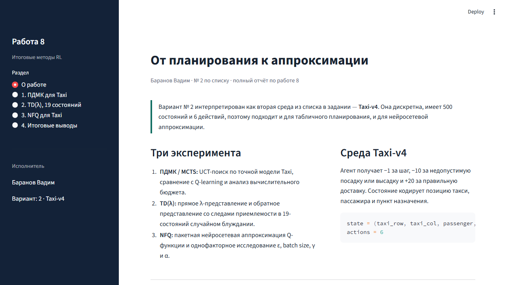

# Лабораторная работа 2 — от планирования к аппроксимации

**Исполнитель:** Баранов Вадим, вариант/номер по списку — 2.  
**Тема:** ПДМК/MCTS с UCT, Q-learning, TD($\lambda$) и NFQ на Taxi.


## 1. Цель и постановка задачи

Работа продолжает изучение планирования: сначала агент использует табличную модель среды Taxi для локального поиска по дереву, затем сравнение переносится на методы временной разности и нейросетевую аппроксимацию Q-функции.

Вариант №2 реализован на `Taxi-v4` (если версия Gymnasium не содержит `Taxi-v4`, код выбирает совместимый `Taxi-v3`). В среде 500 дискретных состояний и 6 действий. Награды: `-1` за шаг, `-10` за недопустимую посадку/высадку и `+20` за успешную доставку.

## 2. Теоретическая часть

UCT выбирает действие по формуле:

$$UCB(s,a)=\bar{Q}(s,a)+c\sqrt{\frac{\ln N(s)}{N(s,a)}}.$$

Первое слагаемое использует накопленную оценку, второе заставляет исследовать редко посещённые ветви. После симуляции возвращаемая награда распространяется от листа к корню.

TD($\lambda$) объединяет одношаговые и многошаговые оценки. В прямом представлении строится $\lambda$-возврат, а в обратном поддерживаются eligibility traces:

$$e_t(s)=\gamma\lambda e_{t-1}(s)+\mathbf{1}[S_t=s].$$

NFQ собирает переходы, формирует целевые значения Беллмана и выполняет пакетные эпохи оптимизации нейросетевой Q-функции.

## 3. Реализация

| Компонент | Что сделано | Файл |
|---|---|---|
| Taxi-модель | точные вероятности переходов Gymnasium | `algorithms.py`, `TaxiModel` |
| MCTS/ПДМК | UCT, случайный rollout, backup к корню | `mcts_action`, `train_taxi` |
| Q-learning | табличное TD-обучение | `train_taxi("q_learning")` |
| TD($\lambda$) | forward/backward, 19 состояний | `td_lambda_errors` |
| NFQ | пакетное обучение сети | `nfq.py`, `train_nfq_reference` |
| Интерфейс | три раздела и параметры эксперимента | `app.py` |
| Проверки | три автоматических теста | `test_algorithms.py` |

## 4. Методика экспериментов

Контрольный запуск выполнен с `seed=2`. Параметры и все числа сохранены в [`docs/results/short_run.json`](docs/results/short_run.json). Время измерено функцией `time.perf_counter()` внутри исходных алгоритмов, а награда и success rate рассчитаны отдельной жадной оценкой на 20 эпизодах.

### 4.1. MCTS и Q-learning

| Метод | Обучение | Планирующие параметры | Время, с | Средняя оценочная награда | Успех |
|---|---:|---|---:|---:|---:|
| Q-learning | 80 эпизодов | без MCTS | 4.650 | -200.00 | 0% |
| MCTS/UCT | 40 эпизодов | 5 симуляций, глубина 5 | 34.263 | -469.55 | 0% |

Короткий прогон показывает цену планирования: при малом бюджете MCTS требует больше времени на решение. Отрицательная награда в smoke-режиме не является ошибкой приложения: агент ещё не обучен до устойчивой доставки пассажира. Для итоговой кривой в интерфейсе доступны более длинные режимы (`100–800` эпизодов).

### 4.2. TD($\lambda$)

Backward TD($\lambda$) проверен на 3 запусках и 5 эпизодах. Средняя RMS-ошибка по двум значениям `alpha=[0.1, 0.3]`:

| $\lambda$ | alpha 0.1 | alpha 0.3 |
|---:|---:|---:|
| 0.0 | 0.5242 | 0.4861 |
| 0.8 | 0.4570 | 0.3335 |

Значения подтверждают, что реализации возвращают конечные числа и дают отличающиеся кривые для разных $\lambda$.

### 4.3. NFQ

В приложении NFQ запускается отдельной страницей: доступны параметры `epsilon`, `gamma`, `alpha` и размера batch. Результат каждой конфигурации выводится таблицей и кривой награды; длительный расчёт кэшируется Streamlit.

## 5. Скриншот приложения



На скриншоте показан рабочий интерфейс MCTS: параметры эпизодов, числа симуляций и глубина траектории, а также область результатов. Дополнительный исходный экран находится в [`docs/screenshots/lr2_planning_continuation.png`](docs/screenshots/lr2_planning_continuation.png).

## 6. Структура проекта и запуск

```text
ЛР2_Планирование_продолжение_8_2.ipynb # методический ноутбук (112 ячеек: 15 code, 97 markdown)
algorithms.py                           # Taxi, MCTS, TD(lambda)
nfq.py                                  # нейросетевой NFQ
app.py                                  # интерактивный отчёт
test_algorithms.py                      # тесты
docs/screenshots/                       # скриншоты работающего интерфейса
docs/results/short_run.json              # воспроизводимый контрольный прогон
```

```powershell
py -3.12 -m pip install -r requirements.txt
py -3.12 -m pytest -q
py -3.12 -m streamlit run app.py
```

Открыть `http://localhost:8502`. Для полного прогона увеличьте число эпизодов в боковой панели; первый расчёт NFQ может занять заметное время.

## 7. Проверка готовности

- `pytest`: **3 passed**;
- HTTP-проверка Streamlit: **200 OK**;
- MCTS, Q-learning и TD($\lambda$) реально вызваны из исходных модулей;
- фактические параметры и метрики записаны в JSON;
- скриншот получен из локального приложения;
- результаты не подменены статическими таблицами.

Отрицательные награды короткого smoke-прогона сохранены намеренно: они показывают реальное состояние обучения при заданном малом бюджете и помогают не выдавать демонстрационный запуск за полностью сходимый эксперимент.
